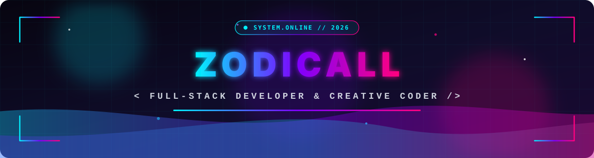

<!-- ANIMATED CYBERPUNK BANNER -->

 

<!-- ANIMATED TYPING SVG -->

 

<!-- NEON STATUS BADGES -->

  
  
  
  

 

<!-- ANIMATED TERMINAL MANIFEST -->

  

## ⚡ `TECH_ARSENAL` // LANGUAGES & TOOLS

 

<!-- SKILL ICONS -->

  

  

 

<!-- COLORFUL TECH PILLS -->

  
  
  
  
  
  
  
  
  
  
  

## 🚀 `FEATURED_DEPLOYMENTS` // PUBLIC LABS

 

<!-- ANIMATED SVG PROJECT CARDS -->

  

<!-- QUICK LAUNCH BUTTONS FOR REPOS -->

  
  &nbsp;&nbsp;
  
  &nbsp;&nbsp;
  

## 📊 `TELEMETRY_&_METRICS` // SYSTEM STATS

 

  
  

  

  

## 🐍 `CONTRIBUTION_MATRIX`

<picture>
  <source media="(prefers-color-scheme: dark)" srcset="https://raw.githubusercontent.com/zodicall/zodicall/output/github-contribution-grid-snake-dark.svg" />
  <source media="(prefers-color-scheme: light)" srcset="https://raw.githubusercontent.com/zodicall/zodicall/output/github-contribution-grid-snake.svg" />
  
</picture>

 

<!-- ANIMATED FOOTER WAVE -->

