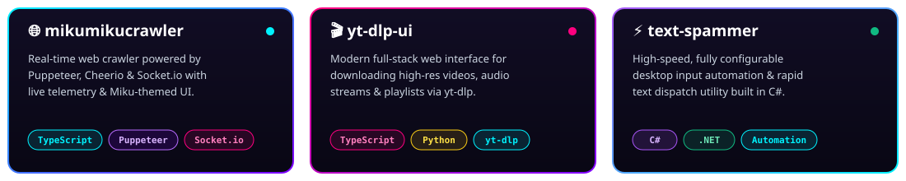

<!-- ELITE MINIMAL HERO -->

  

<!-- BENTO ARCHITECTURE & TELEMETRY -->

  

<!-- MINIMAL TECH STACK -->

  

 

<!-- SELECTED DEPLOYMENTS -->

  
  &nbsp;&nbsp;
  
  &nbsp;&nbsp;
  

 

<!-- MINIMAL PULSE MATRIX -->

